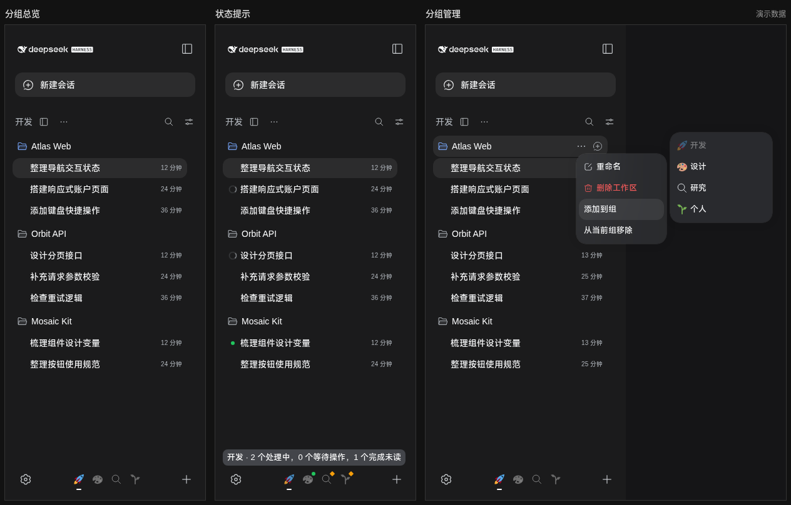

# Nestquay

**English** | [简体中文](README.zh-CN.md)

Workspace groups for the DSH sidebar, so you can find and manage multiple projects more easily.

Organize workspaces by project, purpose, or stage of work. Give each group an icon or emoji and switch between groups from the bottom of the sidebar. Your workspaces and sessions keep their familiar behavior.

## Preview



The screenshot uses fictional workspaces and sessions and shows only the sidebar and group menus.

## Installation

Compatible with DSH **0.2.0-rc.2**.

Use the DSH CLI to install the GitHub Release package into your `web` profile:

```bash
dsh plugin --profile web add https://github.com/HumXC/dsh-nestquay/releases/latest/download/dsh-nestquay.tgz
```

For a custom profile, replace `web` with its name. Restart DSH after installation, then refresh the browser page.

## Getting started

1. Click the view switch beside the sidebar heading to enter the group view.
2. Click **＋** at the bottom, enter a group name, and choose an icon.
3. Open a workspace's **…** menu, choose **Add to group (添加到组)**, and select a group.
4. Click a group icon at the bottom to see its workspaces.

The initial default group is empty. New workspaces created in the group view automatically join the group that was active when creation began. Add existing workspaces through the **Add to group (添加到组)** menu. A workspace can belong to multiple groups. Workspaces without a group remain available in the standard workspace view.

## Managing groups

- **Edit or delete a group:** open the **…** menu beside the current group heading.
- **Remove a workspace from a group:** open its **…** menu inside the group and choose **Remove from current group (从当前组移除)**.
- **Reorder groups:** drag a footer icon. Other icons make room as you move it, and dropping it saves the order. Canceling the drag or dropping outside the navigation restores the original order.
- **Reorder with the keyboard:** focus a group icon and press **Alt + Left Arrow** or **Alt + Right Arrow**.

At least one group must remain, so the last group cannot be deleted. Deleting a group does not delete its workspaces or sessions, or remove those workspaces from other groups.

Groups and the selected view are remembered. Icon order is stored in the current browser and survives page reloads.

## Icons and narrow sidebars

Choose a built-in icon, select an emoji, or paste one. Emoji use a consistent appearance in the picker, preview, and input field. In the footer, inactive groups appear in grayscale; the selected group shows its original colors.

When the sidebar gets narrow, inactive group icons collapse into dots. Hover over or focus a dot to expand the icon and see the group name. If there are many groups, hover near either edge of the navigation bar to scroll.

## Session activity

Footer icons summarize the activity of sessions in each group. Hover over or focus an icon to see the counts.

| Indicator | Meaning |
| --- | --- |
| A sweep of the icon's original colors, or a pulsing dot | A session is running. |
| Green dot | A session has completed and has not been viewed yet. |
| Interaction marker | A session needs your input or approval. |

The completion marker is a reminder to open the session; it does not mean the task result has been verified. Animations are disabled when the system's reduced-motion setting is enabled.

## FAQ

**Does switching groups change the session I am viewing?**

No. Switching groups only changes which workspaces appear in the sidebar. The open session stays the same.

**Where can I find a workspace after removing it from a group?**

It remains in the standard workspace view. If it belongs to other groups, you can also find it there.

**What happens when I disable the plugin?**

The sidebar returns to its standard workspace view. Your workspaces and sessions are unaffected.
